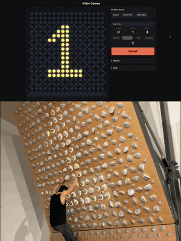
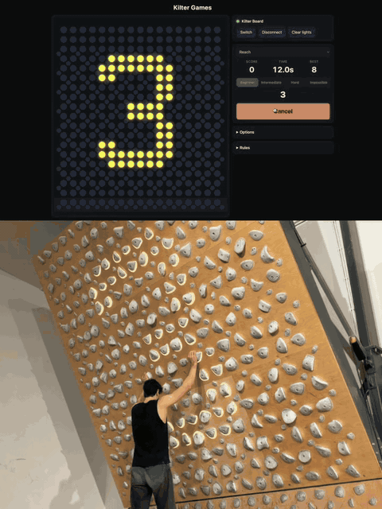

# Kilter Games

Arcade games for the Kilter Board, played on the wall. Your phone talks to the board over Bluetooth and the LEDs become the game.

### ▶ Play at **[kiltergame.vercel.app](https://kiltergame.vercel.app)**

Nothing to install. Open the link in Chrome next to the board.

<h3 align="center">Gap Drop</h3>
<p align="center">
  
</p>

<h3 align="center">Reach</h3>
<p align="center">
  
</p>

## Games

**Gap Drop**: red bars fall down the wall. Lit holds are lava: when a bar passes you, every hand and foot has to be in its gap. The gaps swing between the far left and far right, and the bars speed up as you score.

**Reach**: a cluster of holds lights up somewhere on the wall. Get on it before time runs out (green, then yellow, then red), then it jumps somewhere far away. The time per cluster shrinks as you go.

Both games have **Beginner, Intermediate, Hard and Impossible** modes, plus **Custom**, which has sliders for gap width, speeds, spacing, timings and cluster size. The board counts you in with 3, 2, 1, GO and shows your score at the end. Scoring is on the honor system: if you touch a lit hold or miss the cluster, tap **I'm out**.

## Play

1. Open **[kiltergame.vercel.app](https://kiltergame.vercel.app)** in **Chrome or Edge** on Android, Mac, Windows or ChromeOS. On iPhone, use the free **Bluefy** browser, since Safari has no Web Bluetooth.
2. Close the Kilter app. The board accepts one Bluetooth connection at a time.
3. Pick your board, tap **Connect**, choose a game and mode, then **Start** and put the phone down.

Without a board you can still play on the on-screen preview.

### Supported boards

- **Kilter Board Original:** 12×12 (with or without kickboard), 12×14, 16×12, 8×12, 7×10
- **Kilter Board Homewall:** 7×10, 10×10, 8×12, 10×12, each with Full Ride and Mainline LED kits, plus 7×10 Auxiliary

## Run it yourself

It's a static site with no dependencies or build step.

```bash
npm start   # serves src/ at http://localhost:8000
npm test    # node --test
```

Web Bluetooth needs HTTPS, or `localhost`. The live site is hosted on [Vercel](https://vercel.com) and redeploys on every push to `main`. `vercel.json` serves `src/`.

## How it works

- `src/js/protocol.js` encodes the Aurora board LED protocol. Packets are framed with a checksum and written in 20-byte chunks to the board's UART characteristic. API v2 and v3 are both supported.
- `src/js/ble.js` handles connect, disconnect and reconnect. Only the newest frame is kept while a send is in flight, so a slow link drops frames instead of lagging.
- `src/js/layout.js` turns a board's LED table into a game grid. The main hold lattice becomes the grid, and the offset holds act as footholds.
- `src/js/game.js` and `src/js/reach.js` hold the game rules as pure logic with no DOM or timers, and are tested in `tests/`.
- `scripts/extract-boards.py` regenerates `src/js/boards-data.js` from the Kilter app database.

## Usage stats

The hosted site counts visits (Vercel Web Analytics) and anonymous game events such as board connected, game started and score range (GoatCounter). Neither uses cookies or collects personal data, and nothing is sent when running on `localhost`. Set `GOATCOUNTER_CODE` in `src/js/analytics.js` to send events to your own GoatCounter site.

## Credits

The Bluetooth protocol notes and the board database come from [1-max-1/fake_kilter_board](https://github.com/1-max-1/fake_kilter_board).

## License

The code is [MIT](LICENSE) licensed.

The board LED layout data in `src/js/boards-data.js` is derived from the Kilter Board app's database and isn't covered by the MIT license. Kilter Board is a trademark of its owner. This project is not affiliated with or endorsed by Kilter or Aurora Climbing.
